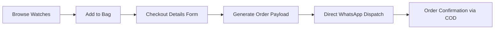

# ✨ Farheesh Store — Luxury Watch Boutique

<p align="center">
  
  
  
  
  
</p>

<p align="center">
  <strong>An ultra-luxury, high-performance eCommerce web application crafted for luxury timepieces and mechanical horology.</strong>
  <br />
  Featuring dynamic SVG watch simulations, real-time interactive mouse lighting, instant WhatsApp ordering, and a seamless shopping bag experience.
</p>

---

## 🌟 Highlights & Features

- ⌚ **Interactive Live SVG Watch Simulation:** Handcrafted SVG watches featuring real-time working clocks, custom dials (skeleton, chronograph, moon-phase, digital, and date complications), ticking hands, and metallic textures.
- 🎨 **Luxury Aesthetic & Motion Design:** Built with a bespoke dark burgundy & champagne palette, smooth mouse-driven parallax reflections, dynamic glassmorphism (`backdrop-blur`), and tailored typography.
- 🛍️ **Complete eCommerce Experience:**
  - Dynamic product catalog filtered by luxury brands (*OLEVS, Seagull, POEDAGAR, SMAEL*).
  - Instant live keyword search.
  - Detailed product quick-view modal with high-res galleries and movement specs.
- 🛒 **Persistent Shopping Cart:** Fully persistent state utilizing browser `localStorage`, with dynamic quantity increments/decrements and instant cart subtotal calculations.
- 📲 **1-Click WhatsApp Direct Checkout:** Direct order generation formatted for WhatsApp dispatch with pre-filled customer delivery details and itemized pricing for Cash on Delivery (COD).
- ⚡ **Blazing Fast Performance:** Powered by Vite, React 18, and lightweight Tailwind CSS utility styling.

---

## 🛠️ Tech Stack

| Technology | Purpose |
|---|---|
| **[React 18](https://react.dev/)** | Core UI component hierarchy, hooks & state orchestration |
| **[Vite](https://vitejs.dev/)** | Lightning-fast development server & optimized build pipeline |
| **[Tailwind CSS](https://tailwindcss.com/)** | Custom typography, luxury color tokens & utility styling |
| **Vanilla SVG & CSS Animations** | Hardware-accelerated watch mechanics, dials, and hands |
| **WhatsApp Click-to-Chat API** | Frictionless serverless order transmission |

---

## 🚀 Quick Start Guide

### Prerequisites
Make sure you have [Node.js](https://nodejs.org/) (v16 or higher) and `npm` installed.

### 1. Clone & Install
```bash
# Clone the repository
git clone https://github.com/your-username/fareesh-storee.git

# Enter the project directory
cd fareesh-storee

# Install dependencies
npm install
```

### 2. Run Development Server
```bash
npm run dev
```
Open your browser and navigate to `http://localhost:5173/` to view the live boutique.

### 3. Build for Production
```bash
npm run build
```
Generates production-ready, minified static assets in the `/dist` directory.

### 4. Preview Production Build
```bash
npm run preview
```

---

## ⚙️ Store Configuration

All store data—including inventory, pricing, brand taxonomy, and WhatsApp order routing—is centrally configured in [`src/data.js`](src/data.js):

### 📞 Configure WhatsApp Ordering
Set your business WhatsApp number (with country code, omitting `+` and spaces):
```javascript
// src/data.js
export const WA = "923294366202";
export const STORE = "Farheesh Store";
```

### 🏷️ Add or Update Products
Add or adjust watch listings directly in the `PRODUCTS` array:
```javascript
// src/data.js
{
  id: 1,
  brand: "Seagull",
  name: "Seagull 1058H Mechanical Vintage Military Watch",
  price: 141743,
  old: 302332,
  desc: "Vintage military styling with a luminous dial...",
  specs: ["Mechanical", "Sapphire glass", "100M waterproof", "Luminous"],
  w: {
    style: "arabic",
    dial: "#23261a",
    mark: "#e8dfb8",
    metal: steel,
    strap: "#5b3a22",
    st: "leather",
    accent: "#c0485f",
    brand: "SEAGULL"
  }
}
```

---

## 📁 Project Structure

```plaintext
fareesh-storee/
├── index.html              # HTML entry point with fonts & metadata
├── package.json            # Scripts & project dependencies
├── tailwind.config.js      # Custom theme colors (champ, olive, burgundy)
├── vite.config.js          # Vite build configuration
└── src/
    ├── main.jsx            # React root mount
    ├── App.jsx             # Main application orchestrator & routing
    ├── data.js             # Catalog items, brand taxonomy & store config
    └── components/
        ├── Watch.jsx       # SVG watch components, dial complications & hands
        ├── Checkout.jsx    # Delivery form & WhatsApp order compilation
        └── ui.jsx          # Cards, hero sections, reviews & UI widgets
```

---

## 📱 Order Flow



---

## 📄 License

This project is created for **Farheesh Store**. All rights reserved.
